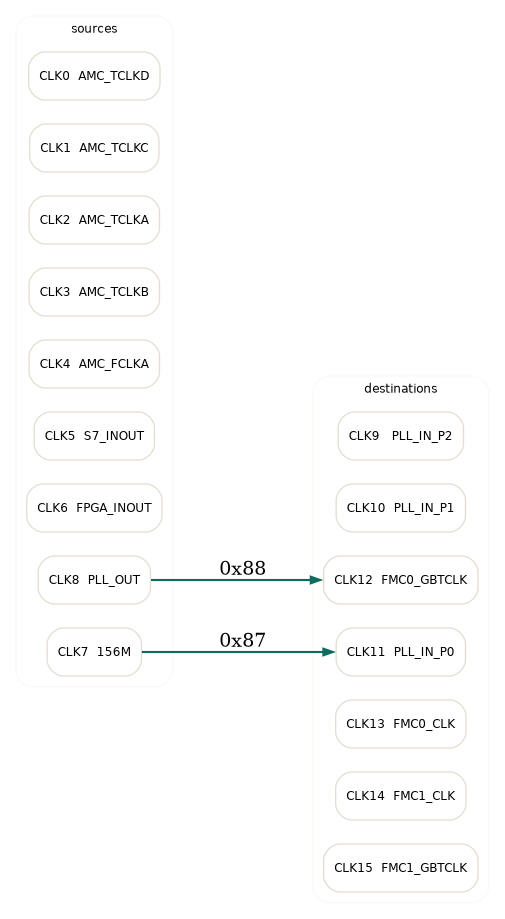
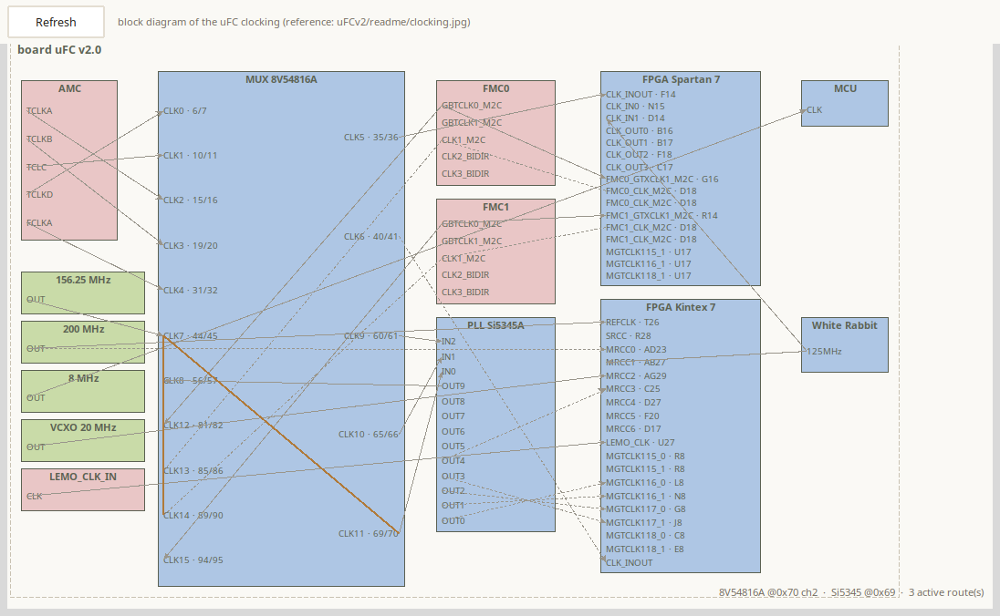

# uFC clock switch (8V54816A) — port map and register format

Source: `uFCv2/UFCV2.pdf`, sheet 5 (“Clock”), symbol `U67`.

Routing can be described with **Graphviz DOT**: `docs/clock_switch.dot` renders
the crossbar on its own, and `docs/clocking.dot` the merged system view used by
the toolbox — every port of the 8V54816A with its configuration (`in`/`out`,
source, termination, polarity and the matrix byte) in the context of the whole
clocking tree, the green edges being the active routes, with the device
addresses (`8V54816A @0x70 ch2`, `Si5345 @0x69`) and the active-route count in
the title:





The picture is rendered by the toolbox from
[tools/clocking/ufc-clocking.json](../tools/clocking/ufc-clocking.json) in a
schematic style: inputs on the left edge of each device box, outputs on the
right edge, orthogonal connection lines whose arrow direction derives from
the points' `dir`, jumper marks where lines cross, and the active 8V54816A
routing in orange.

## The device

Renesas **8V54816A** — a 16-port clock switch. It is **not** a register-indexed
device: every access is a **full 16-byte block transfer** (I²C address `0x58`,
`S_A1 = S_A0 = 0`). Reading the block returns the 16 port configuration bytes;

```
write: [slave addr + W] [port 0] [port 1] … [port 15]
read : [slave addr + R] [port 0] … [port 15]
```

(the MMC driver `modules/idt_8v54816.c` does exactly this, and the generic
command `0x20` can too: `bus=1, mux (0x70,2), dev 0x58, wlen=16`).

## Register format (one byte per port)

| Bit | Name | Meaning |
|---|---|---|
| 7 | Port I/O | 0 = input, 1 = output |
| 6 | Termination | 0 = off (high-Z), 1 = on (100 Ω) |
| 5 | Polarity | 0 = inverted, 1 = non-inverted |
| 4 | — | reserved, 0 |
| 3:0 | Source | for an output: the **input port number** that drives it |

Reset default is `0x00` for every port (all inputs, termination off).

## uFC port assignment (sheet 5)

| Port | Pins | Signal | Direction |
|---|---|---|---|
| CLK0 | 6/7 | `AMC_TCLKD_P/N` | **bidirectional** (TCLKD can be received or driven) |
| CLK1 | 10/11 | `AMC_TCLKC_P/N` | **bidirectional** |
| CLK2 | 15/16 | `AMC_TCLKA_P/N` | **bidirectional** |
| CLK3 | 19/20 | `AMC_TCLKB_P/N` | **bidirectional** |
| CLK4 | 31/32 | `AMC_FCLKA_P/N` | **bidirectional** (FCLKA can be received or driven) |
| CLK5 | 35/36 | `S7_CLK_INOUT_P/N` | **bidirectional** |
| CLK6 | 40/41 | `FPGA_CLK_INOUT_P/N` | **bidirectional** |
| CLK7 | 44/45 | `156M_P/N` (570BAB000544DG) | input (oscillator) |
| CLK8 | 56/57 | `PLL_OUT_P/N` (Si5345 output) | input (from the Si5345) |
| CLK9 | 60/61 | `PLL_IN_P2` (to Si5345 IN2) | **output** (only outputs) |
| CLK10 | 65/66 | `PLL_IN_P1` (to Si5345 IN1) | **output** |
| CLK11 | 69/70 | `PLL_IN_P0` (to Si5345 IN0) | **output** |
| CLK12 | 81/82 | `FMC0_GBTCLK_M2C_P/N` | **bidirectional** |
| CLK13 | 85/86 | `FMC0_CLK_M2C_P/N` (➜ `FMC0_CLK1_M2C`) | **bidirectional** |
| CLK14 | 90/91 | `FMC1_CLK_M2C_P/N` (➜ `FMC1_CLK1_M2C`) | **output** |
| CLK15 | 94/95 | `FMC1_GBTCLK_M2C_P/N` | **bidirectional** |

So ports 0–8 are the available clock **sources**, ports 9–15 are the **outputs**
(three Si5345 PLL inputs and four FMC clocks).

## Example matrices

| Use | Bytes 0…15 | Meaning |
|---|---|---|
| all inputs (reset) | `00` ×16 | switch transparent, no outputs |
| 156M → Si5345 IN0, PLL_OUT → FMC clocks | `00 00 00 00 00 00 00 00 00` then `07 07 07 08 08 08 08` | CLK9–11 = 156M (port 7, output), CLK12–15 = PLL_OUT (port 8, output) |
| FCLKA → Si5345 IN0, PLL_OUT → FMC | … `04` for the PLL input, `08` for the FMC clocks | |

An output byte for the examples above is `0x80 | source` (output, no
termination, non-inverted), e.g. `0x88` = output driven by port 8.

> The routing that the FPGA design expects is a board decision; the switch is
> just a crossbar. The MMC can read/write the whole matrix over IPMI so the
> payload does not have to own it.

## FPGA clock pins

From the FPGA constraint files (`uFCv2/template/S7/top.xdc`,
`uFCv2/template/K7/top.xdc`):

**Spartan 7 — XC7S25‑1CSGA324C**

| Port | Pin (P/N) | Frequency |
|---|---|---|
| `CLK_INOUT_P` | F14 / F15 | 156.25 MHz |
| `CLK_IN_P[0]` | N15 / P16 | 100 MHz |
| `CLK_IN_P[1]` | D14 / D15 | 125 MHz (WR) |
| `CLK_OUT_P[0..3]` | B16/A16, B17/A17, F18/E18, C17/B18 | — |
| `FMC0_GTXCLK_M2C_P` | G16 / G17 | — |
| `FMC1_GTXCLK_M2C_P` | R14 / T14 | — |
| `FMC0_CLK_M2C_P` | D18 / C18 | — |
| `FMC1_CLK_M2C_P` | P14 / P15 | — |
| `FMC0_CLK_C2M_P` | E16 / E17 | — |
| `FMC1_CLK_C2M_P` | R15 / T15 | — |
| `FPGA_GTXCLK_P[0]` | U17 / U18 | — |

**Kintex 7 — XC7K325T‑2FFG900**

| Port | Pin (P/N) | Frequency |
|---|---|---|
| `REFCLK_P` | T26 / T27 | 200 MHz |
| `SRCC_P` | R28 / T28 | 156.25 MHz |
| `MRCC_P[0]` | AD23 / AE24 | 100 MHz |
| `MRCC_P[1]` | AB27 / AC27 | 125 MHz (WR) |
| `MRCC_P[2]` | AG29 / AH29 | 20 MHz (VCXO) |
| `MRCC_P[3]` | C25 / B25 | 250 MHz (DDR) |
| `MRCC_P[4..6]` | D27, F20, D17 | — |
| `LEMO_CLK_IN_P` | U27 / U28 | 40 MHz |
| `MGTCLK116_P0/P1` | L8 / N8 | — |
| `MGTCLK117_P0/P1` | G8 / J8 | — |
| `MGTCLK118_P0/P1` | C8 / E8 | — |
| `MGTCLK115_P0` | R8 | — |

## Schematic corrections

The latest FMC specification names the FMC clock nets differently from the
schematics; `ufc-clocking.json` uses the corrected names:

| schematic | corrected name |
|---|---|
| `CLK0_C2M` | **`CLK1_M2C`** |
| `CLK1_C2M` | **`CLK3_BIDIR`** |
| `CLK1_M2C` | **`CLK2_BIDIR`** |

So each FMC has `GBTCLK0_M2C`, `GBTCLK1_M2C`, `CLK1_M2C`, `CLK2_BIDIR` and
`CLK3_BIDIR` clock points (the FPGA constraint files still use the
schematic-era names such as `FMC0_CLK_M2C_P`).

---

# u4FCP clock switch (ADN4604) — port map and register usage

The u4FCP boards replace the 8V54816A with an **ADI ADN4604** (16 × 16,
nonblocking, 4.25 Gbps, I²C 0x48 on the clock bus `mux 0x70 ch2`). It is a
register-indexed device, driver `modules/adn4604.c`.

## Registers used by the firmware

| Register | Purpose |
|---|---|
| `0x00` | software reset (write 1) |
| `0x20 + n` | TX basic control per output *n*: `[6]` CTL select, **`[5:4]` TX EN** (00 disabled, 01 standby, 10 squelched, 11 enabled), `[2:0]` PE |
| `0x80` | XPT update (write 1 → apply the first-rank map) |
| `0x81` | map table select (0 = map 0, 1 = map 1) |
| `0x82` | XPT broadcast |
| `0x90–0x97` | map 0: two outputs per byte, `[3:0]` = input number of `OUT2n`, `[7:4]` = `OUT2n+1` |
| `0x98–0x9F` | map 1, same layout |
| `0xB0–0xB7` | status: current connectivity of the active map (read only) |
| `0xF0` | termination: `[3]` out 15:8, `[2]` out 7:0, `[1]` in 15:8, `[0]` in 7:0 — **1 = disabled** |
| `0x10/0x11`, `0x12/0x13` | per-input equalizer (0/12 dB) and P/N inversion (`SIGN`), not programmed by the MMC |

Reset defaults: map 0 = `EF CD AB 89 67 45 23 01` (reversed), map 1 =
`10 32 54 76 98 BA DC FE` (straight).

## Configuration model

The clock store's switch record (and the compiled `clock_config_default[]`)
uses the same compact byte model as before: **bit7 = output enable, bits 3:0 =
input select**. `clock_configuration()` translates it into:

1. `0xF0 = 0x0F` — all terminations off (only correct if the far end
   terminates; see `docs/USER_MANUAL.md`, Clock tab);
2. the map bytes into `0x90–0x97` (map 0);
3. `0x20+n = (enabled ? 3 : 0) << 4` for every output;
4. `0x81 = 0` (map 0 active) and `0x80 = 1` (update).

**u4FCP default: all 16 outputs disabled**, all routed from input 8
(`PLL1_OUT`) — `clock_config_default[] = 0x08 ×16`. Enable the outputs that the
FPGA/fan-out actually consumes (the Clock tab's ADN4604 table or the stored
preset).

## Port names (firmware `ADN4604_IN_*`)

| # | signal | # | signal |
|---|---|---|---|
| 0 | `AMC_TX_P17` | 8 | `PLL1_OUT` |
| 1 | `AMC_RX_P17` | 9 | `PLL0_OUT` |
| 2 | `TCLKD` | 10 | `FMC1_CLK_M2C` |
| 3 | `TCLCK` | 11 | `FMC1_CLK_BIDIR` |
| 4 | `TCLKA` | 12 | `FMC0_CLK_M2C` |
| 5 | `TCLKB` | 13 | `FMC0_CLK_BIDIR` |
| 6 | `FCLKA` | 14 | `LEMO_CLK` |
| 7 | `FPGA_CLK_OUT` | 15 | `RTM2AMC_CLK` |

Source: `u4FCPv2/readme/clock.png` (clock block diagram) and the firmware
port defines; the pin-level schematic page for the ADN4604 has not been
transcribed into the clocking JSON yet (only names/directions).
