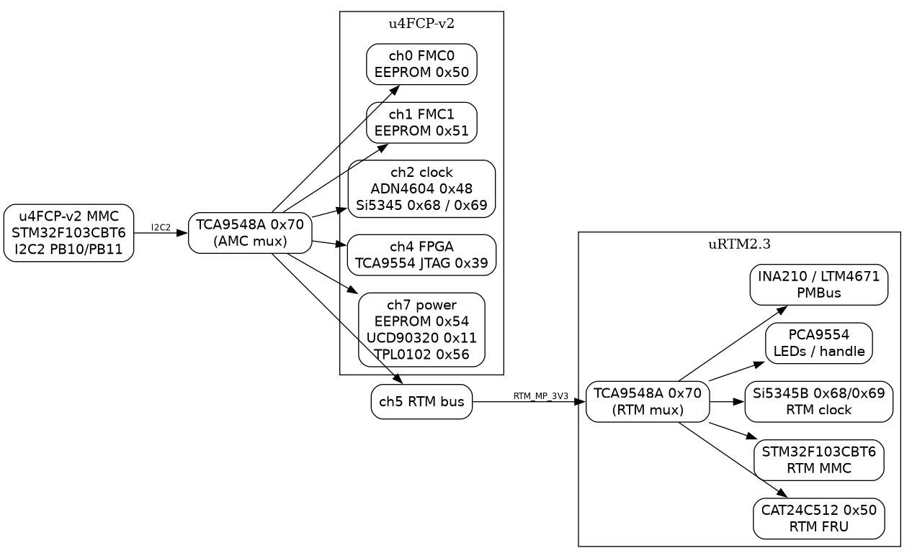

# I²C map — u4FCP‑v2 (AMC) + uRTM2.3 (RTM)



## u4FCP‑v2 — I2C2 bus (PB10/PB11, 100 kHz) behind a TCA9548A `@0x70`

| mux ch | bus | devices | notes |
|---|---|---|---|
| **0** | FMC0 | FMC0 EEPROM `0x50` |  |
| **1** | FMC1 | FMC1 EEPROM `0x51` |  |
| **2** | clock | **ADN4604 `0x48`**, **Si5345 U85 `0x68`**, **Si5345 U61 `0x69`** | the clocking devices (12 V domain) |
| **3** | firefly | (not populated) |  |
| **4** | FPGA | **TCA9554 JTAG `0x39`** | JTAG target select (P4 CON, P5 FMC0, P6 FMC1, P7 RTM) |
| **5** | **RTM** | the uRTM2.3 (see below) | the RTM bus, powered from the RTM MP3V3 |
| **6** | DDR4 | (not populated) |  |
| **7** | power | **FRU EEPROM `0x54`**, **UCD90320 `0x11`**, **TPL0102 `0x56`** | the FRU/clock store, the power sequencer, the FMC VADJ pots |

Notes:
- the channels 4/2/7 are enabled in `i2c_mapping.c` (`enabled=1`), 0/1/3/5/6 are switched on demand;
- `0x32 0x20` (generic I²C transfer) reaches every device, e.g. the UCD:
  `raw 0x32 0x20 0x01 0x01 0x70 0x07 0x11 0x01 0x99 0x01`.

## uRTM2.3 — behind the AMC’s channel 5

| device | address | function |
|---|---|---|
| **TCA9548A** | `0x70` | the RTM’s own 8‑channel mux (3 V3) |
| **CAT24C512YI‑GT3** | `0x50` (strap) | the RTM FRU EEPROM (16‑bit addressing, 64 KB) |
| **STM32F103CBT6** | — | the RTM’s MMC (openMMC `urtm-v2` port), configures the RTM clocks |
| **Si5345B‑D‑GM** | `0x68`/`0x69` | the RTM’s clock PLL (via the RTM mux) |
| **PCA9554** | `0x27`‑ish (strap TBD) | RTM LEDs + hotswap handle (`RTM_GPIO_HOTSWAP_HANDLE` 0, RED 5, GREEN 6, BLUE 7) |
| **INA210 / LTM4671 / LTM4632** | PMBus (TBD) | RTM current monitors and power modules |

Read example through the AMC (once the RTM MP3V3 is enabled):

```
raw 0x32 0x20 0x01 0x01 0x70 0x05 0x50 0x02 0x00 0x00 0x10
  → bus I2C2 · mux (0x70, ch5) · dev 0x50 · addr 0x0000 · 16 bytes
```

The RTM addresses marked TBD need the uRTM2.3 schematic straps transcribed
(CAT24C512 A0‑A2, PCA9554 A0‑A2).  The RTM bus only responds when
`RTM_MP_3V3` (UCD `GPO_RTM_MP_EN`) is enabled — currently not done by the
AMC firmware.
