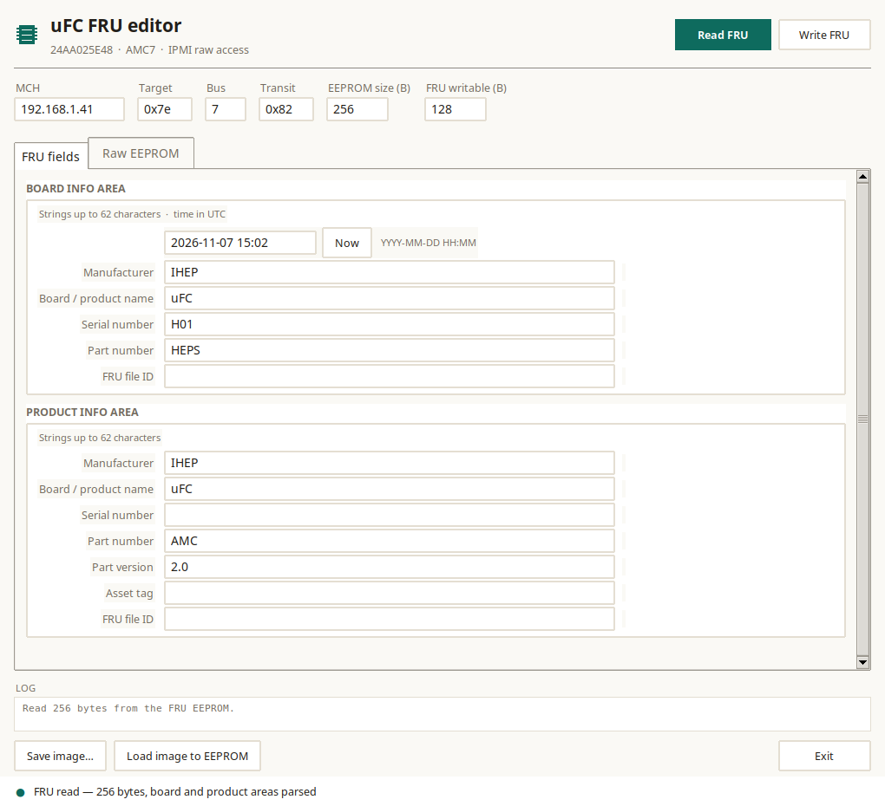

# uFC FRU editor

Desktop application to read and update the uFC **FRU EEPROM** through the MMC,
using the firmware's raw EEPROM commands (custom NetFn `0x32`):

| Cmd | Meaning |
|---|---|
| `0x13` | read: `[addr_lo addr_hi length]` → data |
| `0x12` | write: `[addr_lo addr_hi data…]` |

The firmware must be built with **`-DEEPROM_ACCESS=ON`**.

## Look



## Features

- Quiet desktop styling (warm paper ground, one teal accent, hairline borders,
  Noto Sans / DejaVu Sans Mono), a chip mark in the header, status dot
- Connection fields: MCH IP, target IPMB address, bus, transit address
- One **FRU fields** tab with both the board and product areas, plus a **Raw EEPROM** tab
- Buttons: **Read FRU**, **Write FRU**, **Save image…**, **Load image to EEPROM**
- **Manufacturing time is shown and edited as a UTC date** (`YYYY-MM-DD HH:MM`);
  the app converts it to/from the FRU 24-bit value (minutes since 1996-01-01).
  A **Now** button fills the current UTC time.
- Every string box shows the **FRU specification maximum** (62 characters,
  6-bit type/length field including the NUL) and the fields are rebuilt with
  whatever length is entered — the board/product areas are re-encoded, the
  common-header offsets recomputed and the multirecord area moved after them.
- The whole FRU must fit the configured **writable** region (128 bytes on the
  uFC's 24AA025E48); the tool refuses a write that would overflow and reports
  the required size.
- Board/product fields;
  writing rebuilds only those two areas with fresh checksums and verifies the
  result by reading it back
- Status line and log pane

## Run from source

```sh
# Linux: Tkinter is a separate package on most distributions
sudo apt install python3-tk ipmitool

python3 tools/fru_gui/fru_gui_tk.py --mch 192.168.1.41 --target 0x7e --bus 7
```

Windows: install Python from python.org (Tkinter is included) and put
`ipmitool.exe` in `PATH` or next to the executable.

## Build a standalone binary

The app is plain Python + Tkinter; [PyInstaller](https://pyinstaller.org/)
produces a single-file executable.

```sh
pip install pyinstaller

# Linux
tools/fru_gui/build-linux.sh        # → tools/fru_gui/dist/ufc-fru-editor

# Windows
tools\fru_gui\build-windows.bat     # → tools\fru_gui\dist\ufc-fru-editor.exe
```

`ipmitool` is still an external program: install it system-wide, or place
`ipmitool` / `ipmitool.exe` next to the built executable — the app prefers the
local copy when present.

## Files

| File | Purpose |
|---|---|
| `fru_gui_tk.py` | Tkinter application |
| `fru_core.py` | FRU parsing/building + IPMI raw-transport backend |
| `build-linux.sh`, `build-windows.bat` | PyInstaller builds |

## Options

| Option | Default | Meaning |
|---|---|---|
| `--mch` | `192.168.1.41` | NAT-MCH address (IPMI over LAN) |
| `--target` | `0x7e` | MMC IPMB-L address (AMC7) |
| `--bus` | `7` | IPMB-L bus (`-b`) |
| `--transit` | `0x82` | carrier transit address (`-T`) |
| `--eeprom-size` | `256` | EEPROM image size in bytes (max 65536) |
| `--fru-limit` | `128` | writable FRU bytes (≤ EEPROM size) |

The same two values can be edited in the application's **EEPROM size** /
**FRU writable** fields before pressing *Read FRU*.

The image size is limited to **64 KB** because the raw EEPROM command carries a
16-bit address. Larger devices (e.g. 128 KB) would need a firmware command
extension first; the tool is otherwise generic (any EEPROM whose firmware
implements `0x32/0x12/0x13` with 16-bit addresses).

## Notes

- Writing changes the **live** FRU — save a backup image first.
- The MCH caches the FRU it read at discovery, so `show_fruinfo` may show old
  values until the module is re-discovered (`shutdown <fru>` + `fru_start <fru>`).
  The editor reads the EEPROM directly and always shows the current data.
- Field lengths are fixed by the existing FRU layout; values that do not fit
  are rejected with the maximum length shown.
