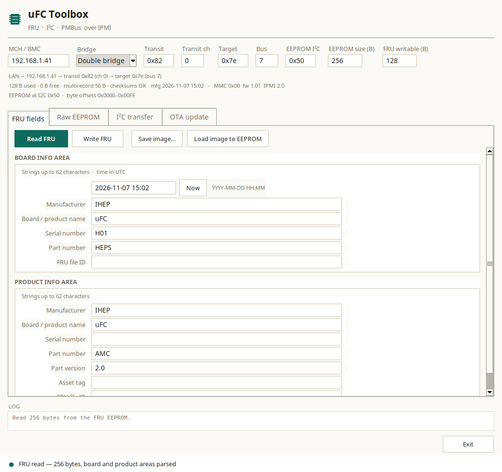

# uFC Toolbox

Desktop application for the uFC module: **FRU EEPROM editing** and
**generic I²C transfers** (EEPROM, PMBus, clock chips) through the MMC,
using the firmware's raw EEPROM commands (custom NetFn `0x32`):

| Cmd | Meaning |
|---|---|
| `0x13` | EEPROM read: `[addr_lo addr_hi length]` → data |
| `0x12` | EEPROM write: `[addr_lo addr_hi data…]` |
| `0x15` / `0x14` | same read/write with an explicit I²C address |
| `0x20` | generic I²C transfer: `[bus n_mux (mux_addr mux_ch)… dev wlen wdata… rlen]` |

The firmware must be built with **`-DEEPROM_ACCESS=ON`** (FRU editing) and
**`-DI2C_ACCESS=ON`** (I²C transfer tab).

## Look



## Features

- Quiet desktop styling (warm paper ground, one teal accent, hairline borders,
  Noto Sans / DejaVu Sans Mono), a chip mark in the header, status dot
- Connection fields: MCH IP, target IPMB address, bus, transit address
- One **FRU fields** tab with both the board and product areas, plus a **Raw EEPROM** tab
- The FRU tab carries its own toolbar: **Read FRU**, **Write FRU**,
  **Save image…**, **Load image to EEPROM** (the header stays a title bar)
- **Manufacturing time is shown and edited as a UTC date** (`YYYY-MM-DD HH:MM`);
  the app converts it to/from the FRU 24-bit value (minutes since 1996-01-01).
  A **Now** button fills the current UTC time.
- Every string box shows the **FRU specification maximum** (62 characters,
  6-bit type/length field including the NUL) and the fields are rebuilt with
  whatever length is entered — the board/product areas are re-encoded, the
  common-header offsets recomputed and the multirecord area moved after them.
- The whole FRU must fit the configured **writable** region (128 bytes on the
  uFC's 24AA025E48); the tool refuses a write that would overflow and reports
  the required size.
- Board/product fields;
  writing rebuilds only those two areas with fresh checksums and verifies the
  result by reading it back
- Status line and log pane

## Run from source

```sh
# Linux: Tkinter is a separate package on most distributions
sudo apt install python3-tk ipmitool

python3 tools/uFC_toolbox/fru_gui_tk.py --mch 192.168.1.41 --target 0x7e --bus 7
```

Windows: install Python from python.org (Tkinter is included) and put
`ipmitool.exe` in `PATH` or next to the executable.

## Build a standalone binary

The app is plain Python + Tkinter; [PyInstaller](https://pyinstaller.org/)
produces a single-file executable.

```sh
pip install pyinstaller

# Linux
tools/uFC_toolbox/build-linux.sh        # → tools/uFC_toolbox/dist/ufc-toolbox

# Windows
tools\uFC_toolbox\build-windows.bat     # → tools\uFC_toolbox\dist\ufc-toolbox.exe
```

`ipmitool` is still an external program: install it system-wide, or place
`ipmitool` / `ipmitool.exe` next to the built executable — the app prefers the
local copy when present.

## What the connection fields mean

The app is not tied to one board: it talks to any MMC/BMC that exposes the
raw EEPROM commands over IPMI. Pick how many hops the request needs:

| Bridge | Use |
|---|---|
| **Double** | MCH → transit → target (MicroTCA AMC behind a crate manager, e.g. AMC7: `-T 0x82 -B 0 -t 0x7E -b 7`) |
| **Single** | MCH → target on one of its buses (`-t`/`-b` only) |
| **Direct** | talk to the MCH/BMC itself, no bridging |

Fields that the selected mode does not use are disabled automatically, and the
path line under the strip shows the resulting route.

With the double bridge the parameters are:

| Field | Meaning |
|---|---|
| **MCH / BMC** | First controller over IPMI-LAN: the crate manager or a BMC. |
| **Transit** | First hop: the intermediate IPMI controller that owns the target's bus. |
| **Transit ch** | Channel from the MCH to the transit controller (usually 0). |
| **Target** | IPMB address of the device that answers (the module's MMC). |
| **Bus** | IPMB channel that reaches the target (per slot on a MicroTCA crate). |
| **EEPROM I²C** | 7-bit I²C address of the EEPROM on the FRU bus (0x50 = board FRU; other addresses use commands 0x14/0x15). |
| **EEPROM size** | Bytes read from the EEPROM (16-bit addressing, max 65536). |
| **FRU writable** | Bytes of the FRU image written (the 24AA025E48 allows the lower 128). |

Single bridging (`-t 0x7e -b 7` without a transit) does not reach the MMC on
this crate; the transit hop is required.

### Where the EEPROM address is

None of the routing fields is the EEPROM's own address. The 24AA025E48 sits at
**I²C 0x50 on the FRU bus, behind TCA9548A channel 0** — that is fixed in the
firmware's chip map (`CHIP_ID_EEPROM`) and not exposed to the host. The raw
commands carry a **16-bit byte offset into the EEPROM** (`0x0000`–`0x00FF` for
the 256-byte part); the tool computes it from the FRU image, which starts at
offset 0. The app shows the range under the connection strip.

Hover any field for a short explanation.

## I²C transfer tab

A generic I²C transaction over IPMI (firmware `-DI2C_ACCESS=ON`, command
`0x20`), for EEPROMs, PMBus devices and clock chips:

- bus (I2C2 by default — everything on the uFC hangs off it),
- up to three mux stages (address, channel),
- device address, **Write len** (numeric), **Write data** (hex, one byte per
  token — must match Write len), **Read len**; a live line shows the resulting
  operation, e.g. `write 1 B · read 8 B → write then read`, and turns red
  when the data count and Write len disagree. Write len 0 → **read only**,
  Read len 0 → **write only**.

Presets: **EEPROM FRU** (0x70 ch0, 0x50, read 8), **UCD PMBus** (0x70 ch0,
0x11, `8B` → READ_VOUT), **Clock 8V54816** (0x70 ch2, 0x58) and **Si5345**
(0x70 ch2, 0x69).

## Board template

The header row `Board template [uFC | u4FCP v1 | u4FCP v2] Load` selects the
board description (`tools/clocking/<template>-clocking.json`); the two u4FCP
hardware revisions share the clocking data but carry their own EEPROM part
(AT24CM01 vs CAT24C512) in the `fru` block. It is shared by all tabs: the
Clock tab uses it for the block diagram, source list and port capabilities,
and the I²C transfer tab shows the selected board above its fields (so
board-specific presets can be added there).

## Clock tab

Three blocks (the **Board template** selector moved to the top bar, shared by
every tab):

1. **8V54816A MUX** — **Read from device** (updates the table), **Write to
   device**, the shared **slot** selector, **Write to flash**, the 16-port
   table (scrolled) and the matrix line.
3. **Si5345 PLL** — **Read from device** (saves a register dump file; if no
   file is loaded, the standard 526-register list embedded in the tool is
   used),
   **Load Si5345 file**, **Write to device**, the same shared **slot**
   selector, **Write to flash**; the second line holds Stored config info and
   the loaded-file name.
   The slot selector is one variable shown in both blocks; Write to flash
   always stores matrix + loaded table and activates it.
4. **Block diagram** — Export diagram (DOT) and System diagram (canvas
   drawing: inputs left, outputs right, jumper marks).

The 8V54816A is configured port by port in a table: **direction** (in/out),
**source** (CLK0…CLK8 for outputs), **100 Ω termination**, **non-inverted**
polarity and the resulting **matrix byte** for each of the 16 ports. The
hardware directions are enforced: **CLK9–CLK11 (PLL_IN_P2/P1/P0) are the only
outputs**, **CLK7 (156M) and CLK8 (PLL_OUT) are inputs**, and the AMC
TCLK/FCLK, S7/FPGA_INOUT and FMC clock ports are bidirectional. A port
switched to output defaults to non-inverted. The matrix line below the table
always shows the 16 bytes that are written to the device.

- **Read clocks** / **Write now** — read/write the switch matrix over I²C
  (mux 0x70 ch2, 0x58)
- The **source** list of every output is taken from `ufc-clocking.json`: all
  mux ports that are capable of being an input (CLK0‑8, CLK12‑15) with their
  signal names
- **Program (built-in)** — firmware command `0x16`, writes the compiled table
- **Load Si5345 file…** — load a ClockBuilder register script
  (e.g. `Si5345-RevD-Registers.txt`); the counts (pre/body/post) are shown
- **Write to device** — writes the loaded table from the PC to the Si5345
  RAM over I²C (page‑aware, 300 ms pause). Effective immediately, **lost on
  power‑cycle**
- **Write to flash** — builds the FRU slot (current matrix + loaded table)
  and uploads it to the MMC clock store (`0x1A/0x1B/0x1C`); it is applied
  when the MMC is rebooted (target slot `auto`/`A`/`B`)
- **slot** selector (placed before the button it affects) — `auto` (write
  the inactive slot, atomic), `A` or `B` (explicit target; the pointer is
  updated after a successful finish)
- **Activate stored config** / **Stored config info** — re-apply the stored
  slot without rewriting it (`0x19`) / show the active slot, length and CRC
  (`0x18`)
- hovering any column header, control or button shows a short explanation in
  the hint line at the bottom of the tab (no help dialog)
- **Status** — command `0x17`
- **Export diagram** — save the merged Graphviz `.dot` (includes the FPGA
  port/pin tables)
- **System diagram** — schematic-style drawing from
  `tools/clocking/ufc-clocking.json`: one box per device with its **inputs on
  the left edge and outputs on the right edge**, orthogonal connection lines
  (arrow direction from the points' `dir`), **jumper marks where lines
  cross**, the active 8V54816A routing in orange, and a board frame around
  everything; **Refresh** redraws after editing the matrix

## OTA update tab

Uploads a PICMG **HPM.1** image to the MMC and activates it (the MMC's HPM
agent stages the image; `activate` writes the `fw_info` record and resets,
then `newboot` copies staging to the application).

- **Firmware file** — `.hpm`, `.bin` or `.hex` (Browse…). A `.hpm` is used as
  is; a `.bin` goes through `bin2hpm -c <component> -n -m 0x315A -p 0x0 -d 0`;
  a `.hex` (Intel HEX) is first converted to a raw image by the tab, then
  through the same `bin2hpm` call. `bin2hpm` must be in `PATH` for `.bin`/`.hex`.
- **Component** — `1` MMC (default), `0` bootloader, `2` payload
- **Check target** — `ipmitool hpm check`
- **Upload** — `ipmitool hpm upgrade <file> -C <component>` (~1 min for 28 KB)
- **Activate** — `ipmitool hpm activate`
- **Upload + Activate** — chains both automatically
- progress bar driven by the `NN%` output, full ipmitool output below

Activation resets the MMC, so the reply usually never arrives: the tab stops
waiting after 25 s and reports *“Activate sent — MMC resetting”*. Read the FRU
again a few seconds later to confirm the module came back.

## Auxiliary information

Below the connection strip the app shows, for every read:

```
LAN → MCH 192.168.1.41 → transit 0x82 (ch 0) → target 0x7e (bus 7)
128 B used · 0 B free · multirecord 56 B · checksums OK · mfg 2026-11-07 15:02
· MMC 0x00  fw 1.01  IPMI 2.0
```

- the bridge path built from the fields,
- FRU image use (used/free bytes), multirecord size and checksum state,
- manufacturing time, and the MMC's Get Device ID (firmware/IPMI version).

## Files

| File | Purpose |
|---|---|
| `fru_gui_tk.py` | Tkinter application |
| `fru_core.py` | FRU parsing/building + IPMI raw-transport backend |
| `build-linux.sh`, `build-windows.bat` | PyInstaller builds |

## Options

| Option | Default | Meaning |
|---|---|---|
| `--mch` | `192.168.1.41` | NAT-MCH address (IPMI over LAN) |
| `--target` | `0x7e` | MMC IPMB-L address (AMC7) |
| `--bus` | `7` | IPMB-L bus (`-b`) |
| `--transit` | `0x82` | carrier transit address (`-T`) |
| `--eeprom-size` | `256` | EEPROM image size in bytes (max 65536) |
| `--fru-limit` | `128` | writable FRU bytes (≤ EEPROM size) |

The same two values can be edited in the application's **EEPROM size** /
**FRU writable** fields before pressing *Read FRU*.

The image size is limited to **64 KB** because the raw EEPROM command carries a
16-bit address. Larger devices (e.g. 128 KB) would need a firmware command
extension first; the tool is otherwise generic (any EEPROM whose firmware
implements `0x32/0x12/0x13` with 16-bit addresses).

## Notes

- Writing changes the **live** FRU — save a backup image first.
- The MCH caches the FRU it read at discovery, so `show_fruinfo` may show old
  values until the module is re-discovered (`shutdown <fru>` + `fru_start <fru>`).
  The editor reads the EEPROM directly and always shows the current data.
- Field lengths are fixed by the existing FRU layout; values that do not fit
  are rejected with the maximum length shown.


## Board clock section

Each `tools/clocking/<template>-clocking.json` may carry a `clock` block:

```json
"clock": {
  "switch": {"part": "ADN4604", "addr": 72, "format": "adn4604"},
  "plls": [{"addr": 104, "part": "Si5345"}, {"addr": 105, "part": "Si5345"}],
  "store": "eeprom"
}
```

It drives the Clock tab: the MUX block title, the PLL selector (`PLL0`,
`PLL1`, ...) and the FRU device-header addresses written into the clock
store slot (switch record: `addr`; Si5345 records: the selected PLL's
`addr`). The uFC uses 0x58/0x69 (8V54816A + one Si5345, flash store), the
u4FCP 0x48/0x68/0x69 (ADN4604 + two Si5345, EEPROM store).


## Board template → FRU EEPROM settings

Selecting the board template (uFC / u4FCP) also applies the board's FRU
storage parameters from its clocking file (`fru` block):

| template | `EEPROM I²C` | `EEPROM size (B)` | `FRU writable (B)` |
|---|---|---|---|
| uFC | 0x50 | 256 | 128 (24AA025E48 half page) |
| u4FCP v1 | 0x54 | 512 | 512 (`FRU_MAX_SIZE`, AT24CM01) |
| u4FCP v2 | 0x54 | 512 | 512 (`FRU_MAX_SIZE`, CAT24C512) |

So a board switch no longer leaves the 128‑byte uFC default in place when
reading/writing an u4FCP FRU.


## Remembered settings

The board template and the connection fields (MCH, bridge, transit/target/bus,
EEPROM address/size/limit) are remembered in `~/.config/ufc-toolbox.json` and
restored on start, so the toolbox reopens with the last used board (and its
FRU storage parameters).


## Header layout

```
MCH / BMC   Bridge   Transit   Transit ch   Target   Bus
Board template [uFC|u4FCP] [Load]   <clocking file>
EEPROM I2C   EEPROM size (B)   FRU writable (B)      <- set by the board template
```

The FRU storage row sits right below the board selector and is filled
automatically when a board is chosen (uFC 0x50/256/128, u4FCP 0x54/512/512).
